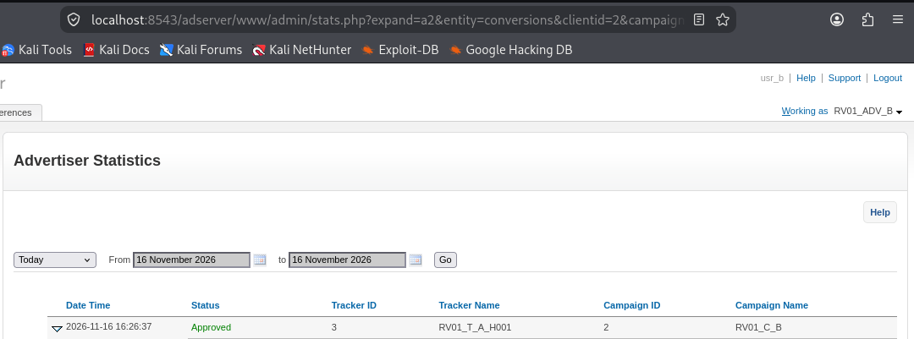
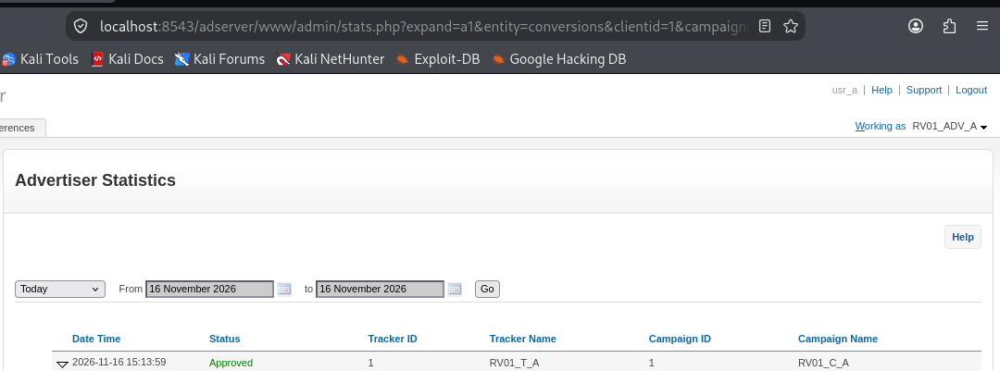
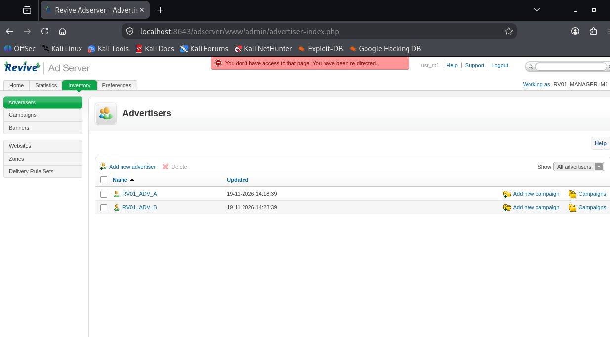

# Cross-advertiser tracker association exposes tracker metadata

**Public technical report | Operação Revive Ads · H001**

Marcio Carvalho · CVE-2026-133202 · 2026-11-25 · v1.0

## 1. Summary and scope

This research identified an access-control flaw in the association of conversion trackers with campaigns in Revive Adserver. A Manager legitimately authorized to administer two advertisers could link advertiser A’s tracker to advertiser B’s campaign. The association persisted and participated in conversion processing. A separate, restricted B user could then see A’s tracker name and identifier in B’s own conversion report.

| Identification | Public outcome |
| --- | --- |
| Author | Marcio Carvalho |
| Vulnerability | CVE-2026-133202 |
| Classification | CWE-284 · Improper Access Control |
| Severity / score | Medium · CVSS 3.0: 5.4 |
| CVSS vector | CVSS:3.0/AV:N/AC:L/PR:L/UI:N/S:U/C:L/I:L/A:N |
| Documented reproduction | Revive Adserver 6.0.8 and 6.0.9 |
| Published fix | Revive Adserver 6.1.0 · 25 November 2026 |
| References | REVIVE-SA-2026-005, item 3 [R1]; HackerOne #4211442 [R2] |
| Report edition | 1.0 · 25 November 2026 |

### Demonstrated impact

Confidentiality: exposure of another advertiser’s tracker name and ID. Integrity: acceptance of an association that violated the product’s ownership rule, followed by its use in conversion attribution. The classification above is the vendor’s published rating [R1].

### Conditions and boundaries

Creating the association required a Manager authorized to administer both advertisers within the same agency. The restricted B user only observed the result. Cross-agency access, reading A’s private totals or revenue, account takeover, unauthenticated exploitation, and creation of the association by an Advertiser user were not demonstrated.

> Scope: investigation H001. All described tests used the researcher’s isolated local installations, synthetic identities and synthetic data.

## 2. Access model and root cause

### Actors and objects in the 6.0.9 reproduction

| Element | Identity / ownership |
| --- | --- |
| Manager | usr_m1: legitimate access to advertisers A and B |
| Advertiser A | usr_a; clientid=1; owns trackers 1 and 3 |
| Advertiser B | usr_b; clientid=2; owns campaign 2 |
| Experimental tracker | trackerid=3; RV01_T_A_H001; automatic association disabled |
| Destination campaign | campaignid=2; RV01_C_B; banner 2 and zone 2 |
| A/A positive control | Campaign 1 (RV01_C_A) and tracker 1 (RV01_T_A) |

### The rule existed but was not enforced on this path

OA_Dll_Tracker, in lib/OA/Dll/Tracker.php, defines the error “Campaign must be owned by same advertiser”. Its linkTrackerToCampaign() method calls checkSameAdvertiser(), which resolves both objects and compares their actual owners [R4]:

```php
return $doTracker->clientid == $doCampaign->clientid;
```

In contrast, the administrative route www/admin/tracker-campaigns.php checked the Manager role and authorization to the advertiser and tracker individually [R3]:

```php
OA_Permission::enforceAccount(OA_ACCOUNT_MANAGER);
OA_Permission::enforceAccessToObject('clients', $clientid);
OA_Permission::enforceAccessToObject('trackers', $trackerid);
```

While processing the submission, the route also filtered each campaign by the request-supplied clientid. That filter was present. The missing comparison was between the tracker’s persisted owner and this advertiser context. The administrative route inserted the relationship directly without calling the DLL’s ownership guard.

> Permission to access two objects does not authorize every possible relationship between them. The missing condition here was: tracker owner = campaign owner.

The reproduction used a valid session, a legitimate CSRF token and matching identifiers in the GET and POST requests. It did not depend on token forgery or disagreement between URL and body parameters.

## 3. Reproduction and proof of persistence

Primary reproduction environment: Revive Adserver 6.0.9 in an isolated laboratory with Apache/PHP 8.3, MariaDB, separate browser profiles and Burp Suite. Times below are UTC on 16 November 2026. IDs refer exclusively to this environment’s synthetic data.

### Application workflow

1. Prepare the objects in section 2 and verify the A/A control. The control recorded an impression at 15:06:43 and a conversion at 15:13:59.
2. Authenticate as usr_m1 and open /adserver/www/admin/tracker-campaigns.php?clientid=2&trackerid=3.
3. Select B’s campaign 2, set the association to Approved (status=4), and save the form using its valid token.

```http
POST /adserver/www/admin/tracker-campaigns.php HTTP/1.1
Host: localhost:8543
Content-Type: application/x-www-form-urlencoded

trackerid=3&clientid=2&action=set&token=[REDACTED]
&campaignids[]=2&statusids[]=4&checkall=&submit=Save+Changes
```

Sanitized excerpt reconstructed for readability; the body is split across two lines for presentation only. Cookies and the token value are omitted. The POST recorded at 16:14:59 received HTTP 302. A redirect alone does not prove persistence.

### Read-only verification query

```sql
SELECT ct.campaignid,
       c.clientid AS campaign_owner_clientid,
       ct.trackerid,
       t.clientid AS tracker_owner_clientid,
       ct.status
FROM rv_campaigns_trackers AS ct
JOIN rv_campaigns AS c ON c.campaignid = ct.campaignid
JOIN rv_trackers AS t ON t.trackerid = ct.trackerid
WHERE ct.campaignid = 2 AND ct.trackerid = 3;
```

| Campaign | Campaign owner | Tracker | Tracker owner | Status |
| --- | --- | --- | --- | --- |
| 2 | 2 (B) | 3 | 1 (A) | 4 |

This result establishes a relationship between different owners. The association was created through the application; no SQL write was used to create it. The campaign 1 / tracker 1 control association remained present.

## 4. Processing and observed disclosure

In a separate visitor profile, /visitor/b.html generated an impression for banner 2 of B’s campaign, in zone 2, at 16:23:20. The /visitor/thank-you-b.html page loaded ti.php?trackerid=3 at 16:26:37. This is an impression-attribution scenario; it does not assume an advertisement click.

The raw rv_data_bkt_a record contained tracker_id=3, creative_id=2, zone_id=2 and status=4. After maintenance observed at 17:22:47, rv_data_intermediate_ad_connection contained tracker_id=3, ad_id=2, zone_id=2, inside_window=1 and connection_status=4. The association therefore affected processing beyond the administrative screen.



*E-09 · Independent usr_b session, 17:33:57 UTC. B’s authorized report displays tracker 3 / RV01_T_A_H001, owned by A, alongside campaign 2 / RV01_C_B.*



*E-10 · usr_a control, 17:28:21 UTC. The tested view shows tracker 1 / RV01_T_A and campaign 1 / RV01_C_A. This control does not establish global directional asymmetry.*

### Negative authorization controls

usr_b received an explicit denial when attempting to open A’s tracker inventory, A’s conversions and the Manager-only association route. The HTTP 302 → 302 → 200 chains ended with a no-access notification. The final HTTP 200 did not mean access to the rejected resource.

> The demonstrated confidentiality effect is A’s tracker name and ID appearing in B’s report. It does not establish access to A’s complete reports, aggregate metrics or revenue.

## 5. Remediation and historical validation

### The vendor’s added check

Commit 07513dca6 [R5], referenced by the advisory, resolves the tracker and requires its owner to match the context’s clientid before proceeding. The excerpt below preserves the code’s logic with editorial line wrapping:

```php
$doTracker = OA_Dal::staticGetDO('trackers', $trackerid);
OA_Permission::enforceTrue(
    $doTracker && $doTracker->clientid == $clientid
);
```

Together with the existing filter on each campaign’s owner, this check prevents the tracker A / campaign B pair. The fix was published in 6.1.0, as documented in the advisory [R1].

### What was tested on 20 November 2026

Before release, the research compared separate 6.0.9 environments: unpatched ORIGINAL, patched CONTROL with clean state, and patched LEGACY with a preexisting inconsistent association. This validation is historical; it is not a dynamic test of the final 6.1.0 distribution.

| Scenario | Recorded result |
| --- | --- |
| ORIGINAL / A-B link | POST accepted; cross-owner association persisted. |
| CONTROL / A-B GET | Access rejected with an explicit message. |
| CONTROL / A-B POST | Fresh attempt with valid session and form rejected; before/after SQL showed no (2,3). |
| CONTROL / A-A link | Legitimate campaign 1 / tracker 3 pair accepted, status=4. |
| LEGACY / old state | New cross-context access blocked, but the existing (2,3) association remained. |

### Blocking new writes versus handling prior data

In LEGACY, a B impression at 16:14:52 and a conversion at 16:17:14 were processed using the old association. B’s restricted report again displayed the tracker at 18:21:03. This describes residual state in the patched 6.0.9 laboratory; it does not demonstrate creation of a new association after the patch, a new bypass, or an independent vulnerability in 6.1.0.

Review of prior data should account for how each association originated and for supported tracker-movement rules. This report does not recommend bulk deletion based solely on current owner mismatch, which could affect legitimate historical data.

> Validation conclusion: the patch blocked new cross-owner associations in CONTROL tests and preserved the legitimate A/A case. No new upgrade experiment using the final 6.1.0 distribution was performed for this publication.

## 6. Evidence appendix and traceability

Index for the 16 November 2026 reproduction. E-01 through E-10 retain their original evidence-supplement identifiers; the table follows chronological order where timestamps are available. SQL and requests in this publication are selected transcriptions.

| ID / UTC time | Evidence | What it supports |
| --- | --- | --- |
| E-01 / E-02<br>16:08:15–16:09:03 | Manager session and A inventory | usr_m1 identity and legitimate context access. |
| E-03<br>16:11:56 | GET: clientid=2 and trackerid=3 | Opening the cross-owner context. |
| E-04<br>16:14:59 | POST action=set and 302 response | Pair submission; excerpt in section 3. |
| E-05<br>After E-04 | SQL JOIN of actual owners | Persistence: campaign 2/B, tracker 3/A, status 4. |
| E-06<br>16:23:20 | B impression; lg.php / SQL | Banner 2, campaign 2 and zone 2. |
| E-07<br>16:26:37 | ti.php pixel / raw conversion | Tracker 3 associated with B’s delivery. |
| E-08<br>17:22:47 | Maintenance and intermediate row | Relationship processed by attribution. |
| E-10<br>17:28:21 | Restricted A screenshot | A/A control; second image in section 4. |
| E-09<br>17:33:57 | Restricted B screenshot | A’s tracker name and ID; first image in section 4. |

### PV-CONTROL · denial after the patch



*20 November 2026 · CONTROL environment capture from the validation supplement. It shows the usr_m1 session and the no-access message following an attempt to open the cross-owner context.*

This capture supports the visual denial; it does not replace the before/after SQL used for the POST test. Published images were extracted from the sanitized supplements. Their user, advertiser, tracker and campaign labels are laboratory data.

## 7. Provenance, disclosure and references

### Documentary basis and revalidation limits

This public edition consolidates the final H001 report, the 6.0.9 reproduction evidence supplement, and the patch-validation report and supplement dated 20 November 2026. The vulnerable code and the fix commit were checked for this edition. Final classification and release information were incorporated from the project’s advisory.

The full 367-item Burp history had been reconciled during the investigation. It was not reprocessed in full for this edition. Queries and results were transcribed from retained records; they were not rerun on 25 November 2026. The public package contains selected evidence, not a complete forensic export.

For the 20 November validation, the repeated negative POST with a valid session is supported by the research log, request capture and before/after SQL; it is not part of the 77-item Proxy excerpt. The LEGACY pixel is also absent from that excerpt: database records and the report support the conversion. The post-maintenance intermediate count was global, not a new tracker-specific row selection.

### Disclosure timeline

| Milestone | Record |
| --- | --- |
| Initial research | Reproduction in 6.0.8; independent confirmation in 6.0.9 on 16 November 2026. |
| 20 November 2026 | Local candidate-patch validation and CONTROL / LEGACY comparison. |
| 25 November 2026 | Release of 6.1.0 and advisory; limited disclosure of HackerOne report #4211442. |
| This edition | Maintainer-authorized publication of the research, with sanitized evidence. |

### Primary references

- **[R1]** [Revive Security Advisory REVIVE-SA-2026-005](https://www.revive-adserver.com/security/revive-sa-2026-005/)
- **[R2]** [HackerOne #4211442](https://hackerone.com/reports/4211442)
- **[R3]** [Revive v6.0.9: www/admin/tracker-campaigns.php](https://github.com/revive-adserver/revive-adserver/blob/v6.0.9/www/admin/tracker-campaigns.php)
- **[R4]** [Revive v6.0.9: lib/OA/Dll/Tracker.php](https://github.com/revive-adserver/revive-adserver/blob/v6.0.9/lib/OA/Dll/Tracker.php)
- **[R5]** [Fix / commit 07513dca6](https://github.com/revive-adserver/revive-adserver/commit/07513dca6)

### Credit and package contents

Research and reporting: Marcio Carvalho. Thanks to the Revive Adserver team for their analysis, remediation and coordinated disclosure through HackerOne. Code excerpts are attributed to the Revive Adserver project.

The package includes this report in Portuguese and English, Markdown versions, three evidence images and SHA256SUMS.txt. The manifest identifies this edition’s files; it does not replace the provenance of the original records. Cookies, credentials, live tokens and private correspondence are excluded from the public material.
