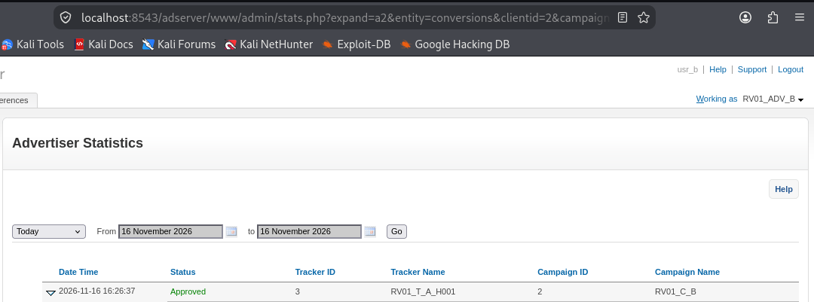
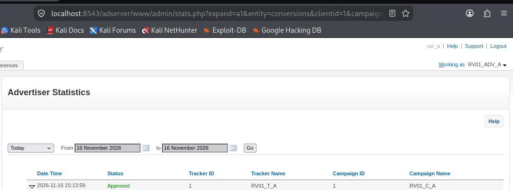
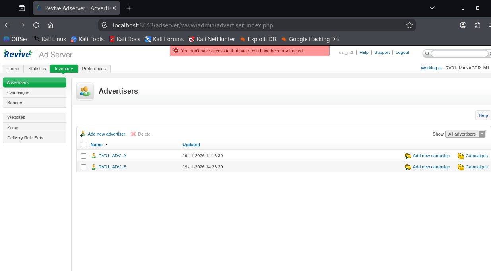

# Associação de tracker entre anunciantes expõe metadados

**Relatório técnico público | Operação Revive Ads · H001**

Marcio Carvalho · CVE-2026-133202 · 2026-11-25 · v1.0

## 1. Resumo e escopo

A pesquisa identificou uma falha de controle de acesso no vínculo entre trackers de conversão e campanhas do Revive Adserver. Um Manager com acesso legítimo a dois anunciantes conseguia associar o tracker de A à campanha de B. A associação era persistida e utilizada no processamento de conversões. Um usuário restrito de B visualizava, então, o nome e o identificador do tracker de A em seu próprio relatório de conversões.

| Identificação | Resultado público |
| --- | --- |
| Autor | Marcio Carvalho |
| Vulnerabilidade | CVE-2026-133202 |
| Classificação | CWE-284 · Controle de acesso inadequado |
| Severidade / pontuação | Medium (média) · CVSS 3.0: 5.4 |
| Vetor CVSS | CVSS:3.0/AV:N/AC:L/PR:L/UI:N/S:U/C:L/I:L/A:N |
| Reprodução documentada | Revive Adserver 6.0.8 e 6.0.9 |
| Correção publicada | Revive Adserver 6.1.0 · 25/11/2026 |
| Referências | REVIVE-SA-2026-005, item 3 [R1]; HackerOne #4211442 [R2] |
| Edição deste relatório | 1.0 · 25/11/2026 |

### Impacto demonstrado

Confidencialidade: exposição do nome e ID de um tracker de outro anunciante. Integridade: aceitação de uma associação incompatível com a regra de propriedade do produto, seguida de seu uso na atribuição de uma conversão. A classificação acima é a publicada pelo fornecedor [R1].

### Condições e limites

O vínculo exigia um Manager autorizado a administrar os dois anunciantes da mesma agência. O usuário restrito de B apenas observou o resultado. Não foi demonstrado acesso entre agências, leitura de totais ou receitas privados de A, tomada de conta, exploração sem autenticação ou criação do vínculo por um usuário Advertiser.

> Escopo: investigação H001. Os testes descritos foram realizados em instalações locais do pesquisador, com identidades e dados sintéticos.

## 2. Modelo de acesso e causa técnica

### Atores e objetos da reprodução em 6.0.9

| Elemento | Identidade / propriedade |
| --- | --- |
| Manager | usr_m1: acesso legítimo aos anunciantes A e B |
| Anunciante A | usr_a; clientid=1; proprietário dos trackers 1 e 3 |
| Anunciante B | usr_b; clientid=2; proprietário da campanha 2 |
| Tracker experimental | trackerid=3; RV01_T_A_H001; autoassociação desativada |
| Campanha de destino | campaignid=2; RV01_C_B; banner 2 e zona 2 |
| Controle positivo A/A | Campanha 1 (RV01_C_A) e tracker 1 (RV01_T_A) |

### A regra existia, mas não era aplicada neste caminho

A classe OA_Dll_Tracker, em lib/OA/Dll/Tracker.php, define o erro “Campaign must be owned by same advertiser”. Seu método linkTrackerToCampaign() chama checkSameAdvertiser(), que resolve os dois objetos e compara seus proprietários reais [R4]:

```php
return $doTracker->clientid == $doCampaign->clientid;
```

Em contraste, a rota administrativa www/admin/tracker-campaigns.php verificava o papel Manager e a autorização individual sobre o anunciante e o tracker [R3]:

```php
OA_Permission::enforceAccount(OA_ACCOUNT_MANAGER);
OA_Permission::enforceAccessToObject('clients', $clientid);
OA_Permission::enforceAccessToObject('trackers', $trackerid);
```

Ao processar a submissão, a rota também filtrava cada campanha pelo clientid fornecido na requisição. Esse filtro existia. Faltava comparar o proprietário persistido do tracker com esse contexto de anunciante. A inserção na tabela de associações ocorria diretamente, sem chamar a validação da DLL.

> Ter permissão para acessar dois objetos não autoriza toda relação possível entre eles. Neste caso, a condição ausente era: proprietário do tracker = proprietário da campanha.

A reprodução utilizou sessão válida, token CSRF legítimo e os mesmos identificadores no GET e no POST. Não dependia de falsificação de token nem de divergência entre parâmetros de URL e corpo.

## 3. Reprodução e comprovação da persistência

Ambiente da reprodução principal: Revive Adserver 6.0.9 em laboratório isolado, com Apache/PHP 8.3, MariaDB, perfis de navegador segregados e Burp Suite. Os horários abaixo são de 16/11/2026, em UTC. Os IDs se referem exclusivamente aos dados sintéticos desse ambiente.

### Procedimento pelo aplicativo

1. Preparar os objetos da seção 2 e confirmar o controle A/A. O controle registrou impressão às 15:06:43 e conversão às 15:13:59.
2. Autenticar como usr_m1 e abrir /adserver/www/admin/tracker-campaigns.php?clientid=2&trackerid=3.
3. Selecionar a campanha 2 de B, definir a associação como Approved (status=4) e salvar o formulário com seu token válido.

```http
POST /adserver/www/admin/tracker-campaigns.php HTTP/1.1
Host: localhost:8543
Content-Type: application/x-www-form-urlencoded

trackerid=3&clientid=2&action=set&token=[REDACTED]
&campaignids[]=2&statusids[]=4&checkall=&submit=Save+Changes
```

Trecho sanitizado reconstruído para leitura; o corpo foi quebrado em duas linhas apenas na apresentação. Cookies e valor do token foram omitidos. O POST registrado às 16:14:59 recebeu HTTP 302. O redirecionamento, isoladamente, não comprova gravação.

### Consulta de verificação, somente leitura

```sql
SELECT ct.campaignid,
       c.clientid AS campaign_owner_clientid,
       ct.trackerid,
       t.clientid AS tracker_owner_clientid,
       ct.status
FROM rv_campaigns_trackers AS ct
JOIN rv_campaigns AS c ON c.campaignid = ct.campaignid
JOIN rv_trackers AS t ON t.trackerid = ct.trackerid
WHERE ct.campaignid = 2 AND ct.trackerid = 3;
```

| Campanha | Dono da campanha | Tracker | Dono do tracker | Status |
| --- | --- | --- | --- | --- |
| 2 | 2 (B) | 3 | 1 (A) | 4 |

Esse resultado comprova a relação entre proprietários diferentes. O vínculo foi criado pelo aplicativo; nenhuma escrita SQL foi utilizada para criá-lo. A associação de controle campanha 1 / tracker 1 permaneceu presente.

## 4. Processamento e exposição observada

Em um perfil visitante separado, /visitor/b.html gerou uma impressão para o banner 2 da campanha B, na zona 2, às 16:23:20. A página /visitor/thank-you-b.html carregou ti.php?trackerid=3 às 16:26:37. O cenário demonstra atribuição por impressão; não pressupõe um clique no anúncio.

O registro bruto em rv_data_bkt_a continha tracker_id=3, creative_id=2, zone_id=2 e status=4. Após a manutenção observada às 17:22:47, rv_data_intermediate_ad_connection continha tracker_id=3, ad_id=2, zone_id=2, inside_window=1 e connection_status=4. Assim, a relação foi utilizada além da tela administrativa.



*E-09 · Sessão independente usr_b, 17:33:57 UTC. O relatório autorizado de B mostra o tracker 3 / RV01_T_A_H001, pertencente a A, ao lado da campanha 2 / RV01_C_B.*



*E-10 · Controle usr_a, 17:28:21 UTC. A visualização testada mostra tracker 1 / RV01_T_A e campanha 1 / RV01_C_A. Esse controle não estabelece uma regra global de assimetria.*

### Controles negativos de autorização

usr_b recebeu negação explícita ao tentar abrir o inventário de trackers de A, as conversões de A e a rota de associação exclusiva de Manager. As cadeias HTTP 302 → 302 → 200 terminavam com aviso de falta de autorização. O HTTP 200 final não significava acesso ao recurso recusado.

> O efeito de confidencialidade comprovado é o nome e o ID do tracker de A dentro do relatório de B. Não se conclui acesso aos relatórios completos, métricas agregadas ou receitas de A.

## 5. Correção e validação histórica

### Verificação adicionada pelo fornecedor

O commit 07513dca6 [R5], referenciado pelo advisory, resolve o tracker e exige que seu proprietário corresponda ao clientid do contexto antes de prosseguir. O trecho abaixo preserva a lógica do código, com quebra de linha editorial:

```php
$doTracker = OA_Dal::staticGetDO('trackers', $trackerid);
OA_Permission::enforceTrue(
    $doTracker && $doTracker->clientid == $clientid
);
```

Em conjunto com o filtro já existente sobre o proprietário de cada campanha, essa verificação impede o par tracker A / campanha B. A correção foi publicada em 6.1.0, conforme o advisory [R1].

### O que foi testado em 20/11/2026

Antes do lançamento, a pesquisa comparou ambientes 6.0.9 separados: ORIGINAL sem patch, CONTROL com patch e estado limpo, e LEGACY com patch e associação inconsistente preexistente. A validação abaixo é histórica; não é um teste dinâmico do pacote final 6.1.0.

| Cenário | Resultado registrado |
| --- | --- |
| ORIGINAL / vínculo A-B | POST aceito; associação cruzada persistida. |
| CONTROL / GET A-B | Acesso recusado com mensagem explícita. |
| CONTROL / POST A-B | Nova tentativa com sessão e formulário válidos foi recusada; SQL antes/depois não mostrou (2,3). |
| CONTROL / vínculo A-A | Par legítimo campanha 1 / tracker 3 aceito, status=4. |
| LEGACY / estado antigo | Novo acesso cruzado foi bloqueado, mas o vínculo (2,3) já existente permaneceu. |

### Limite entre bloquear escrita e tratar dados anteriores

No LEGACY, uma impressão de B às 16:14:52 e uma conversão às 16:17:14 foram processadas a partir da relação antiga. O relatório restrito de B voltou a exibir o tracker às 18:21:03. Esse resultado descreve o estado residual do laboratório 6.0.9 com patch; não demonstra criação de novo vínculo após o patch, novo bypass ou vulnerabilidade independente em 6.1.0.

Uma revisão de dados anteriores deve considerar como cada associação foi criada e as regras de movimentação de trackers. Este relatório não recomenda excluir registros em massa apenas pela divergência atual de proprietário, pois isso pode afetar histórico legítimo.

> Conclusão da validação: o patch bloqueou novas associações cruzadas nos testes CONTROL e preservou o caso legítimo A/A. Não foi executado, para esta publicação, um novo experimento de atualização para a distribuição final 6.1.0.

## 6. Anexo de evidências e rastreabilidade

Índice da reprodução de 16/11/2026. Os identificadores E-01 a E-10 preservam o vínculo com o suplemento de evidências original; a tabela segue a ordem temporal quando há horário disponível. SQL e requisições nesta publicação são transcrições selecionadas.

| ID / horário UTC | Evidência | O que sustenta |
| --- | --- | --- |
| E-01 / E-02<br>16:08:15–16:09:03 | Sessão Manager e inventário de A | Identidade usr_m1 e acesso legítimo ao contexto. |
| E-03<br>16:11:56 | GET com clientid=2 e trackerid=3 | Abertura do contexto cruzado. |
| E-04<br>16:14:59 | POST action=set e resposta 302 | Submissão do par; trecho na seção 3. |
| E-05<br>Após E-04 | SQL com JOIN de proprietários | Persistência: campanha 2/B, tracker 3/A, status 4. |
| E-06<br>16:23:20 | Impressão de B; lg.php / SQL | Banner 2, campanha 2 e zona 2. |
| E-07<br>16:26:37 | Pixel ti.php / conversão bruta | Tracker 3 associado à entrega de B. |
| E-08<br>17:22:47 | Manutenção e registro intermediário | Relação processada na atribuição. |
| E-10<br>17:28:21 | Captura do usuário restrito A | Controle A/A; segunda imagem da seção 4. |
| E-09<br>17:33:57 | Captura do usuário restrito B | Nome e ID do tracker de A; primeira imagem da seção 4. |

### PV-CONTROL · negação após o patch



*20/11/2026 · Captura do ambiente CONTROL, derivada do suplemento de validação. Mostra a sessão usr_m1 e a mensagem de falta de autorização após a tentativa de abrir o contexto cruzado.*

A captura sustenta a negação visual, não substitui o SQL antes/depois usado no teste de POST. As imagens publicadas foram extraídas dos suplementos sanitizados; seus rótulos de usuário, anunciante, tracker e campanha são dados de laboratório.

## 7. Proveniência, divulgação e referências

### Base documental e limites de revalidação

Esta edição pública consolida o relatório final H001, o suplemento de evidências da reprodução 6.0.9 e o relatório e suplemento de validação do patch de 20/11/2026. O código vulnerável e o commit de correção foram conferidos para esta edição. A classificação final e o lançamento foram incorporados a partir do advisory fornecido pelo projeto.

O histórico Burp completo de 367 itens havia sido conciliado durante a investigação. Ele não foi reprocessado integralmente para esta edição. As consultas e seus resultados foram transcritos dos registros preservados; não são consultas executadas novamente em 25/11/2026. O pacote público contém evidências selecionadas, não uma exportação forense completa.

Na validação de 20/11, o POST negativo repetido com sessão válida é sustentado pelo registro de pesquisa, captura de requisição e SQL antes/depois; ele não integra o recorte de 77 itens do Proxy. O pixel do teste LEGACY também não aparece nesse recorte: a conversão é sustentada pelos registros de banco e pelo relatório. A contagem intermediária após manutenção era global, não uma nova seleção linha a linha por tracker.

### Cronologia de divulgação

| Marco | Registro |
| --- | --- |
| Pesquisa inicial | Reprodução em 6.0.8; confirmação independente em 6.0.9 em 16/11/2026. |
| 20/11/2026 | Validação local do patch candidato e comparação CONTROL / LEGACY. |
| 25/11/2026 | Publicação de 6.1.0 e do advisory; divulgação limitada do relatório #4211442 na HackerOne. |
| Esta edição | Publicação da pesquisa autorizada pelo mantenedor; revisão pública com evidências sanitizadas. |

### Referências primárias

- **[R1]** [Revive Security Advisory REVIVE-SA-2026-005](https://www.revive-adserver.com/security/revive-sa-2026-005/)
- **[R2]** [HackerOne #4211442](https://hackerone.com/reports/4211442)
- **[R3]** [Revive v6.0.9: www/admin/tracker-campaigns.php](https://github.com/revive-adserver/revive-adserver/blob/v6.0.9/www/admin/tracker-campaigns.php)
- **[R4]** [Revive v6.0.9: lib/OA/Dll/Tracker.php](https://github.com/revive-adserver/revive-adserver/blob/v6.0.9/lib/OA/Dll/Tracker.php)
- **[R5]** [Fix / commit 07513dca6](https://github.com/revive-adserver/revive-adserver/commit/07513dca6)

### Crédito e conteúdo do pacote

Pesquisa e relato: Marcio Carvalho. Agradecimento à equipe do Revive Adserver pela análise, correção e divulgação coordenada via HackerOne. Trechos de código são atribuídos ao projeto Revive Adserver.

O pacote inclui este relatório em português e inglês, versões Markdown, três imagens de evidência e SHA256SUMS.txt. O manifesto identifica os arquivos desta edição; não substitui a proveniência dos registros originais. Cookies, credenciais, tokens válidos e correspondência privada não integram o material público.
